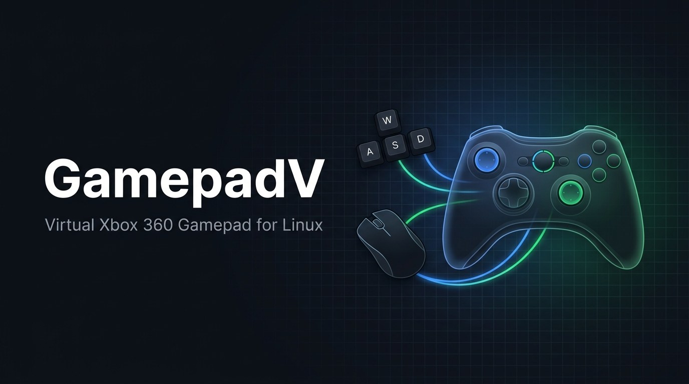
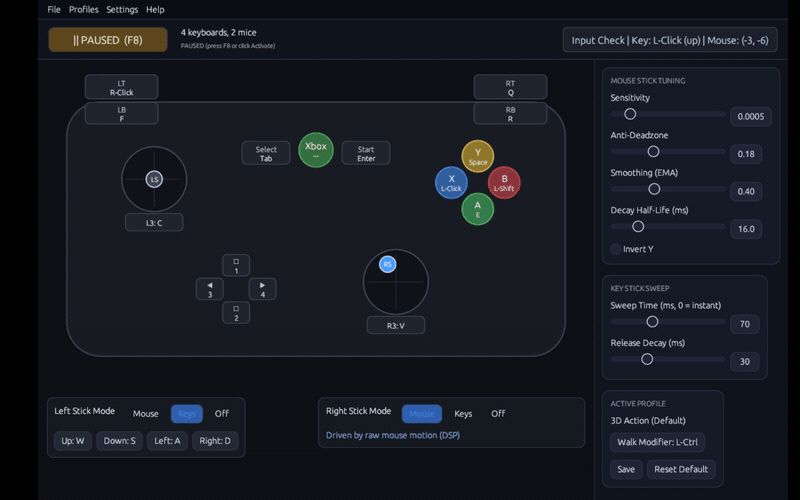

<p align="center">
  
</p>

# GamepadV

**Play controller-only and emulated games on Linux using just your keyboard and mouse—no physical controller required.**

### The Problem
On Linux, playing games or emulators like **Cemu** (*Zelda: BotW / TotK*), **Dolphin**, **RPCS3**, or **Proton/Steam** titles without a physical gamepad is frustrating:
- Built-in keyboard bindings don't let you use your **mouse for smooth 3D camera lookaround**.
- General remappers require tedious manual tuning for mouse-to-analog-stick deadzones, smoothing, and cursor locking.

### What GamepadV Does
**GamepadV** creates a real virtual **Xbox 360 controller** (`uinput`) underneath your keyboard and mouse. Games and emulators detect it as genuine plug-and-play controller hardware—while you get:
- **Smooth Mouse → Stick Lookaround**: 250Hz+ loop with anti-deadzone compensation, EMA velocity smoothing, and exponential decay (no jitter or deadzone snapping).
- **Smooth Keyboard Stick Sweeps**: Optional press-duration ramping and arc-blended turns for `WASD`.
- **Interactive Visual GUI**: Click any button to bind one or multiple keys, or switch either stick to **`Mouse`** in one click.
- **Works on X11 & Wayland**: Locks your cursor (`EVIOCGRAB`) when active (`F8`) and passes through `Alt+Tab` and unmapped keys.
- **Safe Permissions**: Uses a `pkexec` split-daemon so your normal user session never needs global `/dev/input/event*` access.

<p align="center">
  
</p>

---

## Quick Install (All Linux Distros — `x86_64`)

```bash
curl -fsSL https://github.com/rmia46/gamepadv/releases/latest/download/install.sh | bash
```

Works on **Arch Linux, Ubuntu, Debian, Fedora, SteamOS, openSUSE**, and more (installs `gamepadv` + app launcher entry).

<details>
<summary>Manual Package Downloads (.pkg.tar.zst, .deb, .rpm, source)</summary>

- **Arch Linux**: `gamepadv-0.1.0-1-x86_64.pkg.tar.zst` (`sudo pacman -U ...`)
- **Debian / Ubuntu / Mint**: `gamepadv_0.1.0_amd64.deb` (`sudo apt install ./gamepadv_0.1.0_amd64.deb`)
- **Fedora / RHEL / openSUSE**: `gamepadv-0.1.0-1.x86_64.rpm` (`sudo dnf install ...`)
- **All Packages**: [GitHub Releases](https://github.com/rmia46/gamepadv/releases/latest)
- **Build from Source**:
  ```bash
  git clone https://github.com/rmia46/gamepadv.git && cd gamepadv && cargo build --release
  ```

</details>

---

## Usage
1. Launch **`gamepadv`** (from your app menu or terminal).
2. Click **`Unlock Input Engine (pkexec)`** and enter your password *(see [docs/udev-setup.md](docs/udev-setup.md) for permanent `udev` setup)*.
3. **Start your game/emulator after unlocking** so it detects the virtual Xbox 360 controller (`Microsoft X-Box 360 pad`).
4. Press **`F8`** (or click **`|| PAUSED (F8)`**) to toggle capture:
   - **`|| PAUSED (F8)`** — Cursor is free for menus/desktop; live GUI preview still works.
   - **`> ACTIVE (F8)`** — Cursor is locked (`EVIOCGRAB`) and inputs drive the virtual Xbox 360 pad.

---

## Default Controls ("3D Action (Default)")
- `WASD` → Left Stick (`Left Alt` / `Left Ctrl` = Walk modifier)
- `Mouse` → Right Stick
- `Left Click` / `Right Click` → `X` / `LT`
- `Space` / `Left Shift` / `E` / `Q` → `Y` / `B` / `A` / `RT`
- `F` / `R` → `LB` / `RB`
- `1`–`4` → D-Pad
- `Tab` / `Enter` / `C` / `V` → `Select` / `Start` / `L3` / `R3`
